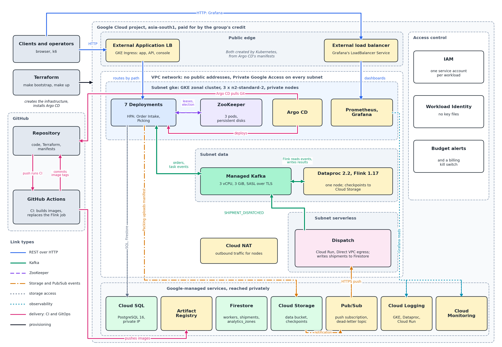
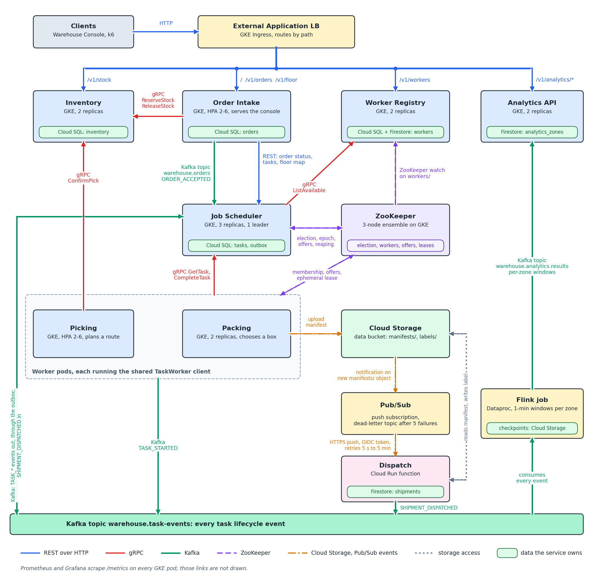

# Smart Warehouse

A cloud-native fulfilment system for picking, packing and dispatch on Google Cloud, with ZooKeeper coordinating work across simulated warehouse workers. CS/SS G527 Cloud Computing, Group 18, scenario S18, with ZooKeeper as the required concept.

- Who owns what: [task_divison.txt](task_divison.txt)
- How to set it up and run it: [Setup and operations](#setup-and-operations), at the end of this page

## Team and task division

| ID number | Name | Tasks | Services |
|---|---|---|---|
| 2025H1120145P | Aakash S D | e. Flink and Kafka<br>h. Metrics and Logging | Order Intake Service<br>Warehouse Analytics Service |
| 2025H1120162P | Aman Kumar | f. ZooKeeper<br>g. Storage | Job Scheduler<br>Worker Registry |
| 2025H1120163P | Pranjal Pandey | a. Infrastructure as Code<br>b. Serverless function and Communication | Inventory Service<br>Dispatch Service |
| 2025H1120167P | Bhagavath M S | c. Kubernetes, HPA and Load test<br>d. GitOps Controller | Picking Service<br>Packing Service |

## 1. System overview

The system runs fulfilment for a warehouse: it accepts orders, reserves stock, splits each order into picking and packing tasks, hands those tasks to workers, and passes finished packages to dispatch. While it runs, it measures throughput, queue depth, and how fast abandoned work is recovered.

The hard problem is not storing orders, but surviving worker failure. A picker can stop partway through a task, and that work must not be lost, done twice, or left waiting forever. ZooKeeper sits at the centre of the design for that reason: it tells the scheduler which workers are alive and who holds which task.

### 1.1 Order lifecycle

1. A client posts the order to **Order Intake**, the public REST service.
2. **Order Intake** reserves stock from **Inventory** over gRPC, stores the order, and publishes it to Kafka.
3. The **Job Scheduler** leader consumes the order and creates one `PICK` task per warehouse zone.
4. The leader offers each task to a live worker through **ZooKeeper**, and that worker takes an ephemeral lease on it.
5. **Picking** workers plan a route and confirm the pick. When the order's last pick completes, the scheduler creates its `PACK` task.
6. A **Packing** worker writes a package manifest to Cloud Storage. Cloud Storage notifies Pub/Sub, which pushes the notification to the **Dispatch** function on Cloud Run.
7. **Dispatch** records the shipment and publishes a dispatch event. Throughout, the **Warehouse Analytics** Flink job aggregates every task event into one-minute windows per zone.

## 2. Cloud deployment architecture

Everything runs in one Google Cloud project in `asia-south1` (Mumbai). GKE nodes, Dataproc, and Cloud SQL have no public addresses, and Kafka and PostgreSQL are reachable only inside the VPC. Two load balancers face the internet: the one GKE's Ingress controller creates for the application, and Grafana's, protected by its admin password.

### 2.1 Architecture overview diagram

Only two load balancers face the internet; the rest is private. Terraform creates the infrastructure inside the project; Argo CD pulls the cluster's contents from GitHub, and CI only pushes images to Artifact Registry.



### 2.2 Cloud component configuration

| Concern | Google Cloud product | Configuration |
|---|---|---|
| Microservices | GKE Standard | One zonal cluster, 3 `n2-standard-2` nodes, Workload Identity |
| Coordination | ZooKeeper on GKE | 3-node ensemble, persistent disks, one pod per node |
| Stream processing | Dataproc | Image 2.2 with the Flink component, one `n2-highmem-2` node |
| Messaging | Managed Service for Apache Kafka | 3 vCPU, 3 GiB, SASL over TLS with Google sign-in, 3 topics |
| Event trigger | Pub/Sub | Cloud Storage notification topic, push subscription, dead-letter topic |
| Serverless | Cloud Run functions | Python 3.12 Dispatch function, Direct VPC egress |
| Relational data | Cloud SQL for PostgreSQL 16 | Enterprise edition, `db-g1-small`, private IP, one schema per service |
| Document data | Firestore | Native mode database `warehouse` |
| Objects | Cloud Storage | Data bucket (manifests, labels), Flink checkpoints, Terraform state, build artifacts |
| Images | Artifact Registry | One Docker repository, written only by CI |
| Public entry | External Application Load Balancer, and a second load balancer for Grafana | The first is created by GKE's built-in Ingress controller, the second by Grafana's `LoadBalancer` Service |
| Observability | Prometheus, Grafana, Cloud Logging | `kube-prometheus-stack` on GKE; logs from GKE, Dataproc, and Cloud Run |
| Deployment | Terraform, Argo CD, GitHub Actions | Two Terraform stacks; GitOps for everything on the cluster |

## 3. Microservices architecture

The diagram shows the eight services, the data each one owns, and the four ways they communicate, each drawn in its own colour: REST over HTTP (blue), gRPC (red), Kafka (green), and ZooKeeper coordination (purple, dashed). A Cloud Storage upload triggers a Pub/Sub notification, drawn dash-dotted in orange.



### 3.1 Following one order through the diagram

1. **REST at the edge.** Clients reach the system only through the external Application Load Balancer created by the GKE Ingress, which routes by path to Order Intake, Inventory, Worker Registry, and the Analytics API. Every other service has no public route.
2. **gRPC where the caller needs the answer.** Order Intake calls Inventory's `ReserveStock` and waits for the reply before accepting the order. Each gRPC call is a single request and reply on the same connection, so each arrow points from the caller to the service and the reply travels back along it. The other gRPC calls work the same way: the scheduler leader asks the Worker Registry for available workers (`ListAvailable`), workers fetch and complete tasks on the Job Scheduler (`GetTask`, `CompleteTask`), and Picking confirms picked stock with Inventory (`ConfirmPick`).
3. **Kafka for everything that can happen later.** An accepted order is published to `warehouse.orders` as `ORDER_ACCEPTED`. The Job Scheduler consumes it and creates one pick task per zone. Every task lifecycle event goes to `warehouse.task-events`, written through a transactional outbox so that no event is lost if a pod crashes.
4. **ZooKeeper for coordination only.** ZooKeeper elects one Job Scheduler leader out of three replicas. Each worker registers itself in ZooKeeper with an ephemeral node, which disappears when its pod dies, and the leader assigns tasks by writing offers under each worker's path in ZooKeeper. No task data passes through ZooKeeper: workers fetch task details over gRPC.
5. **Serverless dispatch through storage events.** Packing uploads each manifest to Cloud Storage. The upload triggers a Pub/Sub push to the Dispatch Cloud Run function, which writes the shipping label, records the shipment in Firestore, and publishes `SHIPMENT_DISPATCHED`. Pub/Sub retries a failed delivery with backoff and moves the message to a dead-letter topic after five failures. Packing never calls Dispatch directly, so a slow or failing Dispatch never blocks a packer.
6. **Stream analytics.** The Flink job on Dataproc consumes every task event, computes one-minute windows per zone, and publishes them to `warehouse.analytics.results`. The Analytics API stores the windows in Firestore (`analytics_zones`) and serves them to the console.

## 4. Microservice responsibilities

Eight services each own one part of the flow and their own data; no service reads another's tables.

| Service | Responsibility | Runs on | Data it owns | Scaling |
|---|---|---|---|---|
| Order Intake | Public API. Validates orders, reserves stock, publishes accepted orders. Serves the web front end: shop, order tracking, and warehouse view. | GKE | Cloud SQL `orders` schema | HPA, CPU 60%, 2 to 6 pods |
| Inventory | Tracks stock. Reserves and releases it atomically, and confirms each pick once only. | GKE | Cloud SQL `inventory` schema | 2 replicas |
| Job Scheduler | Creates tasks, assigns them to workers, manages leases, reclaims abandoned work, relays the event outbox. | GKE | Cloud SQL `scheduler` schema | 3 replicas, one elected leader; no HPA because assignment is single-writer |
| Worker Registry | Tracks which workers are live, their capability, zones, and slots. | GKE | Firestore `workers`, Cloud SQL `workers` schema | 2 replicas |
| Picking | Runs `PICK` tasks: plans a route through the bins, confirms the pick with Inventory. | GKE | None | HPA, CPU 60%, 2 to 6 pods; each pod is one worker station |
| Packing | Runs `PACK` tasks: chooses a box, writes the package manifest. | GKE | Cloud Storage `manifests/` | 2 replicas; each pod is one worker station |
| Dispatch | Records the shipment, writes the label, publishes the dispatch event. | Cloud Run function | Firestore `shipments`, Cloud Storage `labels/` | Scales with the event rate, to zero when idle |
| Warehouse Analytics | Flink job computes per-zone, one-minute windows; an API stores and serves them. | Flink on Dataproc, API on GKE | Firestore `analytics_zones` | One Flink job; API 2 replicas |

Warehouse Analytics has two deployable parts because a Flink job cannot answer queries. Each Picking or Packing pod is one simulated worker station, so scaling the Deployment adds warehouse capacity: a new pod joins ZooKeeper and receives work with no change to the scheduler.

## 5. Interconnection mechanisms

Five mechanisms connect the services, each chosen for what that particular call needs: a synchronous answer, a durable stream, an event trigger, or coordination.

| Mechanism | Used between | Why this mechanism |
|---|---|---|
| REST | Clients and the web front end to Order Intake; Order Intake to Job Scheduler for order and floor views; Analytics and Worker Registry read APIs | Universal for public APIs, easy to inspect, callable straight from a browser |
| gRPC | Order Intake and Picking to Inventory (`ReserveStock`, `ConfirmPick`); Job Scheduler to Worker Registry (`ListAvailable`); workers to Job Scheduler (`GetTask`, `CompleteTask`) | Typed contract and low latency, for calls whose answer the caller needs before it continues |
| Kafka | Order Intake to Job Scheduler; scheduler, workers, and Dispatch to Flink; Flink to the Analytics API | Durable, replayable, many consumers; absorbs a burst of orders without slowing intake |
| Cloud Storage + Pub/Sub push | Packing to Dispatch | Turns a file upload into a retried event, with a dead-letter topic for one that keeps failing |
| ZooKeeper | Job Scheduler, Picking and Packing workers, Worker Registry | Coordination, not data: leader election, live membership, task offers, and leases |

### 5.1 Kafka topics

Three topics carry every asynchronous event; contracts for each live in `contracts/`.

| Topic | Partitions | Producers | Consumers |
|---|---|---|---|
| `warehouse.orders` | 6 | Order Intake | Job Scheduler leader |
| `warehouse.task-events` | 6 | Job Scheduler (via its outbox), Picking and Packing, Dispatch | Flink job; Job Scheduler (marks orders dispatched) |
| `warehouse.analytics.results` | 3 | Flink job | Analytics API |

### 5.2 Reliability details

- **gRPC behind an autoscaler:** gRPC holds one long-lived connection, so a normal Kubernetes Service would pin each client to one pod and new HPA replicas would receive nothing. Headless Services, client-side `round_robin` balancing, and a 30-second `max_connection_age` make clients rediscover pods. Clients retry on `UNAVAILABLE`, which is safe because every RPC is idempotent or fenced: `ReserveStock` is keyed by order, `ConfirmPick` by task, and `CompleteTask` by attempt.
- **No lost events:** A service that writes its database and then publishes to Kafka can crash between the two. The Job Scheduler writes each event into an outbox table in the same transaction as the state change, and the leader relays the outbox to Kafka afterwards. Delivery is at least once, so every consumer is idempotent.

## 6. Design decisions and rationale

Each decision below names the alternative we considered and why we did not choose it.

**1. Why is Dispatch the serverless service?**
Dispatch runs once per packed order and does a short, self-contained job: it writes a shipping label, records the shipment, and publishes one event. It keeps no state between orders and has no part in coordination. As a Cloud Run function triggered by Pub/Sub, it uses no resources while idle and scales with bursts, and Pub/Sub gives it retries and a dead-letter topic with no code of ours. The other services need to stay running:

- Picking, Packing, and the Job Scheduler hold ZooKeeper sessions, which a serverless instance would lose whenever it was paused or removed.
- The Job Scheduler and the Analytics API run continuously as Kafka consumers.
- Order Intake and Inventory sit on every order's request path, where cold starts would add latency.

**2. Why do most services run two replicas?**
This provides redundancy to the system so there is no single point of failure for any service. If one pod crashes, the load balancer and gRPC clients use the other while Kubernetes starts a replacement. It also allows updates without downtime, because a rollout starts a new pod before stopping an old one.

**3. Why does the Job Scheduler run three replicas instead of two?**
Only the leader, elected through ZooKeeper, assigns tasks, so extra replicas add no throughput. They exist for failover. With two replicas, losing the leader leaves a single replica with no standby. With three, a failover still leaves one leader and one standby, and a PodDisruptionBudget of `minAvailable: 2` keeps that standby during node maintenance.

**4. Why do only Order Intake and Picking autoscale?**
They are the two services whose work grows directly with order volume. Each runs a Horizontal Pod Autoscaler (HPA) at 60% CPU, between 2 and 6 pods. Order Intake receives every request from the internet. Picking is the fulfilment bottleneck: an order creates up to three pick tasks, one per zone, but only one pack task. In the live load test at 35 orders per second, Picking scaled from 2 to 6 pods, and Order Intake from 2 to 4, within two minutes. The others stay fixed:

- The Job Scheduler has a single writer, so more replicas add no throughput.
- ZooKeeper slows down as members are added.
- Inventory's work is a short database transaction, so it is limited by Cloud SQL, not by its pods.
- The remaining services see a fraction of the load.

**5. Why is gRPC used between services instead of REST?**
gRPC is used wherever the caller cannot continue without the answer:

| Call | Caller → service | The reply decides |
|---|---|---|
| `ReserveStock`, `ReleaseStock` | Order Intake → Inventory | Whether the order is accepted, and each line's bin |
| `ConfirmPick` | Picking → Inventory | That picked units have left the shelf |
| `ListAvailable` | Job Scheduler → Worker Registry | Which live workers have free slots |
| `GetTask`, `CompleteTask` | Picking, Packing → Job Scheduler | The task's details, and whether a result is accepted |

Each call is one request and one reply. Calls run over persistent HTTP/2 connections, which keeps latency low, and every call has a deadline. REST stays at the public edge, because browsers and load-testing tools speak plain HTTP and JSON.

**6. Why are message queues used, and where?**
A queue is used wherever the sender should not wait for the receiver, or the receiver may be temporarily unavailable:

| Queue | Producer → consumer | Carries |
|---|---|---|
| Kafka `warehouse.orders` | Order Intake → Job Scheduler | Accepted orders |
| Kafka `warehouse.task-events` | Job Scheduler, Dispatch → Flink | Task events and dispatches |
| Kafka `warehouse.analytics.results` | Flink → Analytics API | Per-zone, per-minute results |
| Pub/Sub `warehouse-manifests` | Cloud Storage → Dispatch | One notification per new manifest |

An order is accepted as soon as its stock is reserved, even while the scheduler is changing leaders: the order waits in Kafka until a leader takes it. A burst of orders becomes a backlog instead of failed requests. Pub/Sub is used for Dispatch because Cloud Storage can notify it directly, and a push subscription can call a serverless function with no consumer process running.

**7. Why Kafka?**
Kafka keeps messages in a retained log, and each consumer tracks its own position in it. A newly elected scheduler leader resumes from the last committed position, so no order is skipped. Flink saves its position in every checkpoint, so after a restart it replays exactly the events it had not yet counted. Messages with the same key keep their order, so an order's events are processed in sequence. The managed service runs the brokers outside our cluster and uses Google sign-in instead of stored passwords.

**8. Why do only some services have a public endpoint?**
The load balancer exposes only what a customer or the web console needs, and the only write it accepts is placing an order:

- Order Intake: `/`, `/v1/orders`, and `/v1/floor`, for the console page, ordering, tracking, and the floor map.
- Inventory, the Worker Registry, and the Analytics API: `/v1/stock`, `/v1/workers`, and `/v1/analytics`, all read-only.

Everything that changes or coordinates the warehouse stays inside the cluster: the Job Scheduler, Picking, Packing, and ZooKeeper. The scheduler's views are forwarded through Order Intake rather than exposed directly. Every service's `/health`, `/metrics`, `/docs`, and `/chaos` routes stay private.

**9. Why is Cloud SQL used, and where?**
One PostgreSQL instance holds a schema per service: `inventory` (stock and reservations), `orders` (accepted orders), `scheduler` (orders, tasks, the outbox, and the leader epoch; the leases themselves live in ZooKeeper), and `workers` (worker profiles). This data needs what a relational database guarantees:

- Row locks, so two orders cannot reserve the last unit of stock.
- Unique keys, so a retried order is not created twice.
- Transactions across tables, so a task update and its outgoing event commit together, and a result is accepted only if its attempt number and the leader's epoch are current.

One shared instance keeps each service's data separate at a fraction of the cost of one instance per service.

**10. Why is Cloud Storage used, and where?**
Cloud Storage holds files that are written once and read whole:

- Packing's manifests and Dispatch's labels.
- Flink's checkpoints.
- The Flink JAR and the function's code.
- Terraform's state.

Storing files in the database would bloat it. More importantly, a new manifest triggers a Pub/Sub notification on its own, which makes the hand-off from Packing to Dispatch event-driven with no extra service.

**11. Why is Firestore used for analytics?**
Each Flink result is one small document per zone per minute, stored under `analytics_zones`. It is written by key, so a window that Flink re-sends after a restart simply overwrites itself. The console reads "the latest 30 windows for a zone" as one ordered query every 15 seconds. Firestore needs no server to size, costs almost nothing at this volume, and survives `make down`, so history is kept between demos. The alternatives fit worse:

- Cloud SQL would put analytics writes on the transactional database.
- BigQuery is built for large scans, not frequent small reads.
- Bigtable's minimum cost is far above this workload.

# Setup and operations

Everything below is for running the project: where the code lives, keeping inside the credit, running it locally, and deploying it to Google Cloud.

## Repository layout

| Path | Contents |
|---|---|
| `services/` | The eight services. Python, except `analytics-flink`, which is Java. |
| `libs/warehouse_common/` | Shared logging, metrics, Kafka, ZooKeeper and Google Cloud code |
| `proto/`, `contracts/` | gRPC definitions and Kafka event schemas |
| `infra/` | Terraform: `bootstrap` runs once, `runtime` holds everything billed by the hour |
| `gitops/` | Kubernetes manifests and Argo CD configuration |
| `load-tests/` | k6 load test |
| `scripts/` | Bring-up, teardown, quota check and failure injection |
| `tests/` | Integration tests and stubbed tests of the ops scripts |

## Spending only the credit

The project runs on the group's Google Cloud credit: ₹28,663 (about $300) on a billing account that runs until 30 December 2026. That billing account is a **paid account**, so once the credit is used up Google charges the card behind it. Three things stop that from happening.

1. **A budget across the whole billing account.** The credit belongs to the account, and every project on it draws from the same credit, so `make bootstrap` creates a budget over all of them. It counts gross cost, before credits, from the day you start, and emails the billing administrators at 50%, 75%, 90% and 100%.
2. **A kill switch.** When that spending reaches `budget_amount`, a Cloud Run function unlinks billing from this project, which stops everything in it. Cost reports lag usage by hours, so set `budget_amount` well below the credit left: about ₹22,000 of the ₹26,988 left on 5 November leaves a margin of more than two days of running. `make killswitch-check` confirms the function holds the permission it needs, without using it.
3. **Nothing runs unattended.** `make down` destroys everything billed by the hour. Dataproc also deletes itself 12 hours after creation, in case `make down` is forgotten, and Terraform refuses to run more than 8 vCPUs at once.

Teammates get project roles but no billing role, so only the billing administrator can change how the project is paid for. Any other project on the same billing account, such as one created for the Gemini API, spends the same credit, so keep those idle.

The stack costs about **$0.90 (₹86) an hour** while it runs. These are Google's list prices for `asia-south1`, read from the Cloud Billing Catalog on 5 November 2026; Managed Kafka's compute units come from its pricing page. Left running around the clock it would use the whole credit in under two weeks, so run `make down` whenever you stop.

| Item | Size | $/hour |
|---|---|---|
| GKE nodes | 3 × n2-standard-2 | 0.350 |
| Managed Kafka | 3 vCPU and 3 GiB, the minimum: 2.1 compute units, plus its endpoints | 0.26 |
| Dataproc | 1 × n2-highmem-2, plus the Dataproc fee | 0.177 |
| Cloud SQL | db-g1-small, Enterprise edition, zonal, 10 GB HDD | 0.044 |
| Load balancer, NAT, IP addresses, disks | | about 0.07 |
| GKE management fee | One zonal cluster | 0, the GKE free tier pays it |
| Cloud Storage, Firestore, Pub/Sub, Cloud Run functions, Cloud Logging | Small usage | mostly inside the free tier |

The machines are N2 because this project has no E2 quota in `asia-south1`. `make preflight` checks that quota as well as the overall one.

## Run it locally, with no Google Cloud project

This needs Docker with Compose.

```bash
make local-up        # builds and starts everything
make smoke           # sends one order through the system
make load            # needs k6: sustained traffic against localhost
make local-down
```

Order Intake is on `localhost:8080`, Analytics on `localhost:8090`, and the Flink dashboard on `localhost:8081`.

Here is what stands in for each Google Cloud service:

| On Google Cloud | Locally |
|---|---|
| Managed Service for Apache Kafka | Kafka, without TLS or sign-in |
| Cloud SQL | PostgreSQL |
| Cloud Storage | [fake-gcs-server](https://github.com/fsouza/fake-gcs-server), which also publishes the upload notifications |
| Pub/Sub, Firestore | Google's own emulators |
| Cloud Run function | `local_runner.py`, which pulls from Pub/Sub and calls the same handler |
| Dataproc | Flink 1.17 JobManager and TaskManager containers |
| GKE, load balancer | Docker networking |

## Set up a computer

One script installs every tool this project uses, at the versions it was tested with: the Google Cloud CLI with `kubectl`, Terraform, kustomize, Helm, kubeconform, k6, Maven with a Java 11 JDK, Docker, and a Python environment in `.venv`.

**Linux** (Debian 13, or Ubuntu 24.04 and later):

```bash
./scripts/setup-linux.sh                # asks for your sudo password for apt and Docker
./scripts/setup-linux.sh --no-sudo      # only what goes in your home folder
```

**Windows** (10 version 2004 or later, or 11): the scripts here are bash, so they run in WSL, a real Ubuntu inside Windows. From PowerShell, in the repository folder:

```powershell
powershell -ExecutionPolicy Bypass -File scripts\setup-windows.ps1
```

The first run needs PowerShell opened as Administrator, and asks for a restart once WSL is on; run it again afterwards. It installs Ubuntu 24.04, copies the repository to `~/warehouse-cloud` inside it, and runs the Linux script there. Work from that copy, in the Ubuntu terminal.

Both are safe to run again. Each download is checked against a pinned SHA-256, and a tool that is missing, broken or a different version is replaced.

## Run the tests

```bash
source .venv/bin/activate
docker compose up -d zookeeper-1 zookeeper-2 zookeeper-3 postgres
make test
```

None of the tests need a Google Cloud project. Terraform is planned against mocked providers.

## Deploy to Google Cloud

### 1. Tools

Run the setup script for your system, from [Set up a computer](#set-up-a-computer).

### 2. Check the billing account

In the console, open **Billing**, choose the billing account, and look at:

- **Credits**: how much is left, and the end date. Set `budget_amount` well below what is left.
- **Overview**: whether it says *Paid account* or shows an **Activate** button for a Free Trial. On a paid account the card is charged once the credit is gone, which is why the budget and kill switch exist.
- **The currency.** Indian accounts are often in INR, and the budget must use the same currency.
- **Any banner asking to verify the account.** Verify it, or Google can suspend the account and stop everything.

### 3. Sign in

There are no key files anywhere in this project. You sign in as yourself, CI gets short-lived credentials from GitHub through Workload Identity Federation, and pods, Dataproc and the functions run as their own service accounts.

```bash
gcloud auth login                         # for gcloud commands
gcloud auth application-default login     # for Terraform and local Python clients
```

### 4. Create the project

```bash
gcloud projects create <project-id>
gcloud billing accounts list                                    # find the account id
gcloud billing projects link <project-id> --billing-account <account-id>
gcloud config set project <project-id>
gcloud auth application-default set-quota-project <project-id>
make preflight                                                  # vCPUs free, overall and for N2, against the 8 the stack needs
```

### 5. Create the long-lived resources

This makes the state bucket, image registry, Firestore, CI identity, team access, the budget, the kill switch, and the service accounts the running stack uses. Google limits how many service accounts a project may create per minute, so if it stops with that error, wait a minute and run `make bootstrap` again.

```bash
cp infra/bootstrap/terraform.tfvars.example infra/bootstrap/terraform.tfvars   # then edit it
make bootstrap
make killswitch-check
```

`make killswitch-check` sends the kill switch a self-test. A minute later its log should say `can_unlink_billing: true`. It never turns billing off itself.

### 6. Connect GitHub

Create the repository and push the code. Under **Settings → Secrets and variables → Actions → Variables**, set:

| Variable | Value |
|---|---|
| `GCP_PROJECT_ID` | The project id |
| `GCP_REGION` | `asia-south1` |
| `GCP_WORKLOAD_IDENTITY_PROVIDER` | The `ci_workload_identity_provider` output of `make bootstrap` |
| `GCP_CI_SERVICE_ACCOUNT` | The `ci_service_account` output |

These are variables, not secrets: none of them grants access on its own. Push to `main` and CI builds every image and commits its tag to `gitops/`.

### 7. Upload the Flink job

```bash
make flink-jar
```

### 8. Bring everything up

Managed Kafka alone takes 20 to 30 minutes, so allow an hour before a demo. If the run is cut off, for example by a lost network connection, run `make up` again: `scripts/recover.sh` finds what the first run created but did not record, adopts it with Terraform `import` blocks, and the apply creates only the rest. For a private repository, `make up` reads Argo CD's read-only deploy key from `../argocd_deploy_key`, outside the repository, or from `DEPLOY_KEY_FILE`.

```bash
cp infra/runtime/terraform.tfvars.example infra/runtime/terraform.tfvars   # then edit it
make up
BASE_URL=http://<printed-address> make smoke
```

Then open `http://<printed-address>/` in a browser. That is the **web front end**, served by Order Intake, with three views:

- **Shop**: 300 products in three departments, one per picking zone, with live stock and how many of each have been picked. Add them to a cart, choose a delivery speed (Standard, Express or Priority, which set the order's priority) and place the order.
- **Your orders**: every order placed from that browser, tracked live through picking, packing and dispatch, with the warehouse tasks, workers and attempt numbers behind each one.
- **Warehouse**: a map of the floor showing where each picker is working, the live workers with a history of pods joining and leaving, charts of Flink's last 30 windows, every recent order, and a load generator whose Rush hour setting makes the autoscaler add pickers.

It uses only the public API. To work on the page without Google Cloud, `make console` serves it with a fake API on `localhost:8099`; the fake API never runs in the cloud.

### 9. Tear it down when you finish

```bash
make down
```

The order inside `make down` matters, and the script handles it. Kubernetes created the load balancer and the ZooKeeper disks, so they must go first, or Terraform cannot delete the network and the disks keep billing. The script finishes by listing anything left. Expect it to stop with an error on two network objects, the `serverless` subnet and the Cloud SQL peering: Google holds them for a while after Cloud Run and Cloud SQL are deleted. They cost nothing, and the next `make up` reuses them.

### Teammates

Add each teammate's Google account email to `team_members` in `infra/bootstrap/terraform.tfvars` and run `make bootstrap` again. Each of them then runs, on their own machine:

```bash
gcloud auth login
gcloud config set project <project-id>
gcloud container clusters get-credentials warehouse --zone asia-south1-a
```

They can see everything, use `kubectl`, read logs and redeploy the Flink job, but they have no billing access. Changes reach the cluster through Git and Argo CD, so each member's work shows in their own commits.

### Checks to make on the first deployment

The documentation did not settle these. Each has a fallback.

| Check | If it fails |
|---|---|
| Managed Kafka creates in `asia-south1` for this project | Run Kafka in the cluster instead, which takes vCPUs from the same cap |
| Managed Kafka accepts a replication factor of 3 at its minimum size | Set `kafka_replication_factor = 2` |
| The Pig job starts Flink on Dataproc | Run `/tmp/submit-flink.sh` from an SSH session on the node |
| Flink writes checkpoints to `gs://` | Point `CHECKPOINT_DIR` in `flink.env` at `hdfs:///flink-checkpoints` |
| Flink logs appear in Cloud Logging as `yarn-userlogs` | Read them from the YARN UI |
| Pub/Sub push reaches the function | Check the function's logs and the dead-letter subscription |

## Useful commands on Google Cloud

```bash
kubectl -n warehouse get pods,hpa
./scripts/chaos.sh status

# Argo CD on localhost:8443. User admin, password from:
kubectl -n argocd get secret argocd-initial-admin-secret -o jsonpath='{.data.password}' | base64 -d
kubectl -n argocd port-forward svc/argocd-server 8443:80

# Grafana has its own public address. User admin; the password is grafana_admin_password
# in infra/runtime/terraform.tfvars, or a generated one if that is empty.
make grafana

# The YARN and Flink web UIs, through Dataproc's Component Gateway
./scripts/flink-ui.sh

# Manifests that failed five deliveries to the Dispatch function
gcloud pubsub subscriptions pull warehouse-dispatch-dead-letters --limit 5
```
