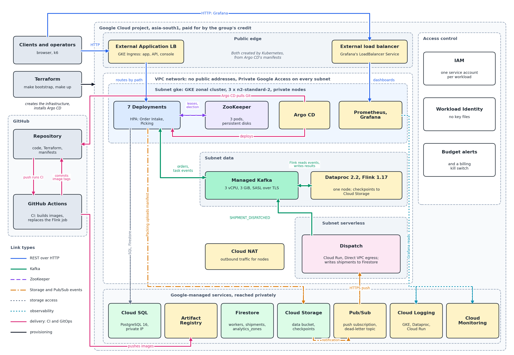
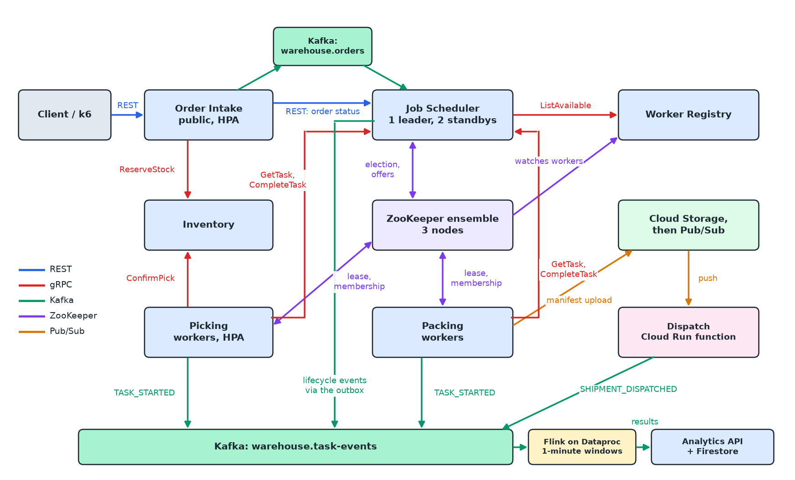
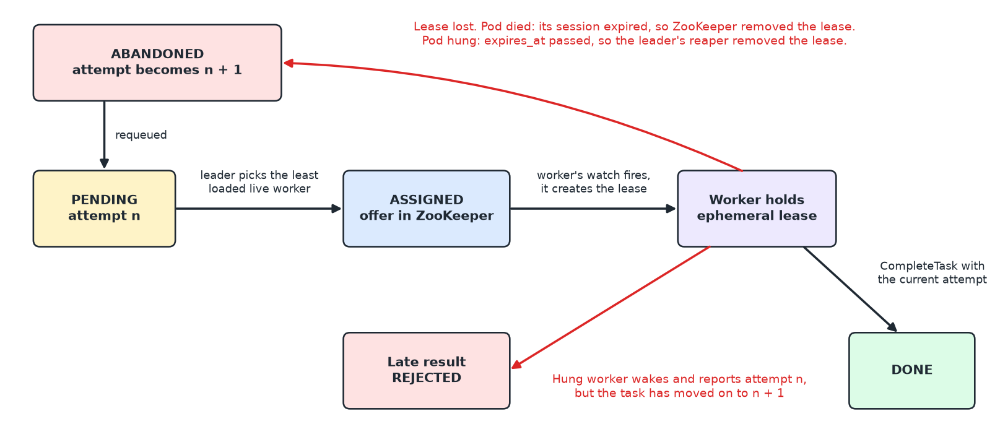

# Smart Warehouse: Design Document

**CS/SS G527 Cloud Computing, Group 18**

Scenario S18: Smart Warehouse (picking, packing and dispatch). Required concept: ZooKeeper system.

| ID number | Name | Tasks | Services |
|---|---|---|---|
| 2025H1120145P | Aakash S D | a. Infrastructure as Code, d. GitOps | Order Intake, Inventory |
| 2025H1120162P | Aman Kumar | c. Kubernetes and HPA, f. ZooKeeper | Job Scheduler, Worker Registry |
| 2025H1120163P | Pranjal Pandey | e. Flink, h. Observability | Warehouse Analytics, Picking |
| 2025H1120167P | Bhagavath M S | b. Serverless and communication, g. Storage | Dispatch, Packing |

## 1. System overview

The system runs fulfilment for a warehouse. It accepts orders, reserves stock, splits each order into picking and packing tasks, gives those tasks to workers, and hands finished packages over for dispatch. It measures throughput, queue depth and abandoned-task recovery as it runs.

The hard problem in a warehouse is not storing orders. It is that workers fail. A picker can stop partway through a task, and the work must not be lost, done twice, or left waiting forever. That is why ZooKeeper sits at the centre of the design: it tells the scheduler which workers are alive and who holds which task.

An order passes through the system in seven steps:

1. A client posts the order to **Order Intake**, the public REST service.
2. Order Intake reserves stock from **Inventory** over gRPC, stores the order, and publishes it to Kafka.
3. The **Job Scheduler** leader consumes the order and creates one picking task per warehouse zone.
4. The leader offers each task to a live worker through ZooKeeper, and that worker takes an ephemeral lease.
5. **Picking** workers plan a route and confirm the pick. When the last pick finishes, the scheduler creates a packing task.
6. A **Packing** worker writes a package manifest to Cloud Storage. Cloud Storage notifies Pub/Sub, which pushes the notification to the **Dispatch** function on Cloud Run.
7. Dispatch records the shipment and publishes a dispatch event. Throughout, the **Warehouse Analytics** Flink job aggregates every event into one-minute windows.

## 2. Cloud deployment architecture



Everything runs in one Google Cloud project in `asia-south1` (Mumbai), chosen for low latency during the demo and load test. GKE nodes, Dataproc and Cloud SQL have no public addresses. The only public entry point is the load balancer that GKE's Ingress controller creates.

| Concern | Google Cloud product | Configuration |
|---|---|---|
| Stateless services | GKE Standard | One zonal cluster, 3 `n2-standard-2` nodes |
| Coordination | ZooKeeper on GKE | 3 pods, persistent disks, one pod per node |
| Stream processing | Dataproc | Image 2.2 with the Flink component, one `n2-highmem-2` node |
| Messaging | Managed Service for Apache Kafka, Pub/Sub | 3 vCPU and 3 GiB, the minimum, SASL over TLS; one topic with a push subscription and a dead-letter topic |
| Serverless | Cloud Run functions | Python 3.12, Direct VPC egress |
| Storage | Cloud Storage, Cloud SQL, Firestore | See section 8 |
| Public URL | External Application Load Balancer | Created by GKE's built-in Ingress controller |
| Observability | Prometheus, Grafana, Cloud Logging | See section 11 |

**Fitting the credit.** The group's credit of about $300 pays for everything, so the compute is capped at 8 vCPUs to keep the hourly cost predictable, although the project's quota is 32. The GKE nodes take 6 and Dataproc takes 2. Managed Kafka, Cloud SQL and Cloud Run run in Google's own projects, so they do not count. Terraform refuses any plan above the cap, node upgrades replace one node at a time rather than adding a surge node, and the HPAs stop at 6 pods. The machines are N2 because the project has no E2 quota in `asia-south1`, and `make preflight` checks the machine family's quota as well as the overall one. Section 14 covers how spending stays inside the credit.

## 3. Microservices architecture



| Service | Responsibility | Runs on | Data it owns |
|---|---|---|---|
| Inventory | Tracks stock. Reserves and releases it atomically, and confirms picks once only. | GKE | Cloud SQL `inventory` schema |
| Order Intake | Public API. Validates orders, reserves stock, and publishes accepted orders. Also serves the web front end: a shop, order tracking and a warehouse view, in one page that uses only the public API. | GKE, with HPA | Cloud SQL `orders` schema |
| Job Scheduler | Creates tasks, assigns them to workers, manages leases, reclaims abandoned work. | GKE, 3 replicas | Cloud SQL `scheduler` schema |
| Worker Registry | Tracks which workers are live and what they can do. | GKE | Firestore `workers`, Cloud SQL `workers` schema |
| Picking | Runs picking tasks: plans a route, confirms the pick. | GKE, with HPA | None |
| Packing | Runs packing tasks: chooses a box, writes the manifest. | GKE | Cloud Storage `manifests/` |
| Dispatch | Records dispatch and shipment hand-off. | Cloud Run function | Firestore `shipments`, Cloud Storage `labels/` |
| Warehouse Analytics | Computes throughput, queue depth and recovery metrics, and serves them. | Flink on Dataproc, plus an API on GKE | Firestore `analytics_zones` |

Warehouse Analytics has two deployable parts because a Flink job cannot answer queries. The Flink job computes the windows, and a small API stores and serves them.

Each Picking or Packing pod is one simulated worker station, which keeps the model simple and has a useful consequence: scaling the Deployment adds warehouse capacity. A new pod joins ZooKeeper and starts receiving work with no change to the scheduler.

## 4. Interconnection mechanisms

Each mechanism was chosen for what that particular call needs.

| Mechanism | Used between | Why this mechanism |
|---|---|---|
| **REST** | Clients and the web front end to Order Intake, Inventory's stock list, Analytics and Worker Registry; Order Intake to Job Scheduler, including the order and floor views behind the front end | Universal for public APIs, easy to call and inspect, and callable straight from a browser |
| **gRPC** | Order Intake and Picking to Inventory, Job Scheduler to Worker Registry, workers to Job Scheduler | A typed contract and low latency, for calls where the caller must have the answer before it continues |
| **Kafka** | Order Intake to Job Scheduler, all services to Flink, Flink to Analytics | Durable, replayable, many consumers, and it decouples a burst of orders from assignment speed |
| **Cloud Storage and Pub/Sub** | Packing to Dispatch | Turns a file upload into a retried event, with a dead-letter topic for one that keeps failing |
| **ZooKeeper** | Job Scheduler, workers, Worker Registry | Coordination rather than data: membership, leases and leader election |

**Kafka topics.** `warehouse.orders` carries accepted orders. `warehouse.task-events` carries every lifecycle event. `warehouse.analytics.results` carries Flink's output and is separate, as the brief requires. Schemas live in `contracts/`, and a test keeps the Python producers in step with them.

**gRPC behind an autoscaler.** gRPC holds one long-lived connection, so a normal Kubernetes Service would pin each client to one pod, and new HPA replicas would receive nothing. The system combines headless Services, client-side `round_robin` balancing, and a 30-second `max_connection_age` that makes clients rediscover pods. Clients also retry on `UNAVAILABLE`, so a worker does not lose a finished task when its call lands on a replica that was just killed. Those retries are safe because every RPC is idempotent or fenced: `ReserveStock` is keyed by order, `ConfirmPick` by task, and `CompleteTask` by attempt.

**No lost events.** A service that updates its database and then publishes to Kafka can crash between the two. The Job Scheduler avoids this with a transactional outbox: events are written in the same database transaction as the state change, and the leader relays them to Kafka afterwards. Delivery is at-least-once, so every consumer is idempotent.

## 5. ZooKeeper: the required concept

### 5.1 Why ZooKeeper fits this domain

ZooKeeper offers strongly ordered writes, ephemeral nodes that vanish when their owner's session ends, and watches that notify clients of changes. Three warehouse problems map directly onto those primitives:

| Warehouse problem | ZooKeeper primitive | How it is used |
|---|---|---|
| Two schedulers assigning the same work | Ephemeral-sequential nodes | Leader election: only the leader assigns |
| Knowing which workers are alive | Ephemeral nodes, watches | Each worker holds a membership node, and the registry watches the group |
| Noticing that a task was abandoned | Ephemeral nodes, watches | A worker holds a lease on its task, and the leader watches the leases |

The system runs a real three-node ensemble rather than simulating these behaviours. A majority is needed for writes, so it keeps working through the loss of any one node.

### 5.2 Znode layout

```
/warehouse
  scheduler/election/n_0000000012   ephemeral-sequential   one per scheduler replica
  scheduler/epoch                   persistent             version is the leader epoch
  workers/<capability>/<worker>     ephemeral              live membership
  assignments/<worker>/<task>@<n>   persistent             the leader offers attempt n of a task
  leases/<task>                     ephemeral              owned by the working worker's session
  config/lease_ttl_seconds          persistent             watched by workers, applies live
```

ZooKeeper holds coordination state only. Task contents stay in PostgreSQL, because ZooKeeper keeps all its data in memory and is not built for payloads or high-volume queues.

### 5.3 Leader election

Each scheduler replica creates an ephemeral-sequential node, and the lowest sequence number leads. Every other replica watches only the node immediately before its own. When the leader dies, exactly one successor wakes. Watching the leader directly would wake every replica at once, which is the herd effect the design avoids.

Only the leader assigns work, reaps leases, consumes Kafka and relays the outbox. All replicas serve reads and `CompleteTask`, because the check that matters lives in the database.

### 5.4 Task lifecycle



An ephemeral lease detects a dead process. It cannot detect a stuck one, because a stuck process keeps its session open. Session liveness does not prove progress. So each lease also carries `expires_at`, which the worker keeps renewing, and the leader's reaper removes any lease that lapses. The two mechanisms cover different failures.

A reclaimed task goes to the front of the queue, ahead of any priority. Its order has already lost time to a failure, and behind a backlog its recovery time would measure queueing rather than recovery.

### 5.5 Fencing

Detecting failure is not enough, because a worker declared dead may not know it. A hung worker can wake up and report a result after its task has been given to someone else. ZooKeeper cannot stop that on its own, because the stale worker's request goes to the database rather than to ZooKeeper. So every reclaim increments the task's attempt number, which acts as a fencing token, and the completion is conditional:

```sql
UPDATE scheduler.tasks SET status = 'DONE'
WHERE task_id = %s AND worker_id = %s AND attempt = %s AND status = 'ASSIGNED'
```

A stale attempt matches no row and is rejected. A leader epoch protects assignment in the same way: a paused leader that wakes after losing leadership has an old epoch, so its assignments match nothing.

### 5.6 Failure handling

| Failure | How it is detected | Recovery |
|---|---|---|
| Scheduler leader dies | Its election node disappears after the session timeout (10 s) | The next replica takes over, with a higher epoch |
| Worker pod dies mid-task | Its lease and membership nodes disappear | The leader requeues the task as attempt n + 1 |
| Worker hangs | Its lease `expires_at` passes | The reaper removes the lease, and the same requeue path runs |
| Hung worker reports late | Its attempt number is stale | The database rejects the result |
| One ZooKeeper node dies | The ensemble keeps its majority | Clients reconnect to a remaining node |
| ZooKeeper connection is lost | The session goes SUSPENDED | The leader pauses assignment until it knows its session survived |

Failing over the election is not enough, because the leader also owns a Kafka consumer. A killed leader keeps its partitions until its group session expires, which takes 45 seconds by default. Testing showed the new leader winning the election and then waiting 30 seconds for orders. The session timeout is therefore 10 seconds, no longer than the ZooKeeper session, so the partitions are free by the time a successor asks for them.

## 6. Serverless function: Dispatch

Dispatch is a natural fit for serverless. It runs only when a package is ready, needs no idle capacity, and scales with the event rate.

The chain is a Cloud Storage upload, then a Pub/Sub notification, then a push to a Cloud Run function. The upload notification is filtered to `manifests/`, so the labels the function writes back cannot trigger it again. Pub/Sub buffers bursts, and any reply other than 2xx makes it retry with backoff from 5 seconds to 5 minutes. After five failed deliveries a message moves to a dead-letter topic, where a subscription keeps it for a week for inspection. Terraform creates the push subscription itself, rather than leaving it to an event trigger, because only an explicit subscription can carry a dead-letter policy.

The function signs in to everything as its own service account. Pub/Sub signs each push request as a separate account, and only that account may invoke the function. Kafka has only private addresses, so the function joins the VPC through Direct VPC egress, which needs no connector VMs to eat into the vCPU quota.

Cloud Storage notifications and Pub/Sub both deliver at least once, so a manifest can arrive twice. Firestore's `create()` refuses a shipment that already exists, which makes the second delivery a no-op. The steps run in a deliberate order: the Kafka event is published before the shipment is recorded. A crash between the two is retried and consumers absorb the duplicate, whereas the reverse order could record a shipment that no consumer ever hears about.

## 7. Stream processing: Warehouse Analytics

The Flink job runs on Dataproc and consumes `warehouse.task-events`. For each zone and each one-minute tumbling window it computes:

- Tasks created, picks and packs completed, and shipments dispatched
- Tasks abandoned and reclaimed, and mean recovery time
- Unique active workers
- Queue depth

Results go to the separate `warehouse.analytics.results` topic.

**Stateful aggregation.** Each window keeps running totals, including a set of worker ids. Queue depth needs more than that, because it carries over between windows, so it lives in keyed state that outlives each window. Flink checkpoints this state to Cloud Storage every 30 seconds and restores it after a failure.

**Event time.** Windows use each event's own timestamp, not its arrival time. The source parses events itself so that it can assign these timestamps and track watermarks per Kafka partition.

**Watermark.** The watermark trails the newest event by 20 seconds. That figure is deliberate. Events in the outbox wait for a new leader during a failover of about 11 seconds, so a shorter bound would drop them as late.

**Running on Dataproc.** Image 2.2 ships Flink 1.17 on Java 11, so the job is built against exactly those. Flink runs one YARN application per job. Terraform has no Flink job type for Dataproc, and gcloud's is in private preview, but image 2.2 installs Pig and Google documents running shell commands from a Pig job. So a Pig job runs `infra/runtime/dataproc/submit-flink.sh`, which replaces any running copy of the job and submits the new one. Terraform starts the job this way, and CI replaces it the same way.

**Signing in to Kafka.** Managed Kafka accepts only Google-authenticated clients. The job uses Google's own login handler, which presents the Dataproc node's service account. The Python services build the same token themselves from their Workload Identity credentials, following Google's sample.

**Late events** go to a side output and are logged. They are not counted, because re-firing a closed window would apply its queue-depth change twice.

## 8. Storage design

The system uses three storage products, each matched to its data.

| Product | Data | Why this product |
|---|---|---|
| **Cloud SQL for PostgreSQL** | Orders, stock, tasks, outbox, worker profiles | Needs transactions. Stock reservation and task fencing both rely on atomic conditional updates. |
| **Firestore** | Live worker state, shipments, analytics windows | Simple document access at high write rates, with `create()` for idempotency. |
| **Cloud Storage** | Package manifests, shipping labels, Flink checkpoints | Whole objects, cheap, and an upload can trigger an event. |

One Cloud SQL instance holds a separate schema per service, and no service reads another's tables. This keeps service boundaries without paying for four databases. PostgreSQL 16 defaults to the Enterprise Plus edition, which has no small machines, so Terraform names the Enterprise edition to keep the shared-core `db-g1-small`.

Analytics windows are stored at `analytics_zones/{zone}/windows/{window_start}`. Reading a zone's newest windows then orders by one field, which Firestore indexes automatically, so no composite index is needed.

## 9. Scaling and load testing

| Service | Autoscaling | Reason |
|---|---|---|
| Order Intake | HPA, CPU 60%, 2 to 6 pods | Stateless, and takes the public traffic |
| Picking | HPA, CPU 60%, 2 to 6 pods | Each pod adds worker capacity |
| Job Scheduler | None, 3 replicas | Assignment is single-writer by design, so replicas are standbys |

An HPA scales on CPU, and a worker that sleeps to simulate work uses none. So Picking does real work, planning each route with a nearest-neighbour and 2-opt heuristic. The `ROUTE_STOPS` setting controls the cost per task.

An HPA measures utilization as a share of the pod's CPU request, so each request was set from measured cost rather than guessed:

| Service | Measured CPU | CPU request | Target per pod | Load that crosses the target with 2 pods |
|---|---|---|---|---|
| Order Intake | 3 to 5 ms per request | 100m | 60m | 24 to 40 orders per second |
| Picking | 18 ms per task, at `ROUTE_STOPS=90` | 250m | 150m | About 16 tasks per second, or 9 orders per second |

Order Intake's first request of 250m would have stayed at 30% or less at 30 orders per second and never scaled, which is why it was lowered. These costs were measured on a developer machine, and `n2-standard-2` nodes may well be slower, which only makes scale-out happen sooner. Six pods is the ceiling because six vCPUs hold everything on the cluster.

The k6 test in `load-tests/orders.js` uses an arrival-rate executor. A fixed set of virtual users would slow down along with the system and hide the overload, whereas this keeps offering orders at the target rate.

HPA pods multiply database connections, so each pod's pool is capped at 3 connections, or 6 for the scheduler.

## 10. Infrastructure as Code and GitOps

**Terraform** provisions all infrastructure, in two stacks. `infra/bootstrap` holds what must outlive a teardown: the state bucket, the image registry, Firestore, the CI identity, team access, and the budget with its kill switch. `infra/runtime` holds everything billed by the hour, so it can be destroyed each night and recreated for the demo. Both stacks are tested with `terraform test` against mocked providers, and those tests pin the settings that decide the bill.

**Argo CD** deploys everything on the cluster. An app-of-apps root tracks `gitops/`, and each child Application has automated sync, pruning and self-heal.

**The hand-off.** Terraform writes a ConfigMap and a Secret holding endpoints and credentials, and creates the Kubernetes service accounts that Workload Identity ties to Google service accounts. Manifests in Git refer to these by name, so they contain no project ids, endpoints or secrets.

**A deployment is a commit.** GitHub Actions builds the images, pushes them to Artifact Registry, and commits the new tags to `gitops/`. It never touches the cluster. Argo CD notices the commit and rolls it out.

Flink runs on Dataproc and the Dispatch function on Cloud Run, outside Kubernetes, so GitOps does not apply to them. CI replaces the Flink job through the same Dataproc job Terraform uses, and the function redeploys whenever Terraform sees its source change.

## 11. Observability

**Metrics.** Prometheus scrapes every service, and each exposes request counts, errors and latency. Grafana dashboards are generated from code and deployed through GitOps:

| Dashboard | Shows |
|---|---|
| Service RED | Requests per second, error rate and latency for HTTP and gRPC |
| Cluster Health | Replicas, HPA state, pod and node CPU and memory, restarts |
| ZooKeeper | Quorum, sessions, znodes, latency, current leader and epoch |
| Warehouse KPIs | Queue depth, live workers, throughput, recovery time, fenced results |
| Central Logs | Logs from every service, Flink and Dispatch, and one order followed across all of them |

**Logging.** All logs reach Cloud Logging with no agent of our own: GKE ships container logs, Dataproc ships the YARN container logs that hold Flink's, and Cloud Run captures the function's. Services log one JSON object per line, with `severity`, `order_id`, `task_id` and `worker_id` as fields, so one query follows an order across every service. Grafana reads Cloud Logging and Cloud Monitoring through its own Workload Identity account.

## 12. Security

- No key file exists anywhere. Pods sign in through Workload Identity, Dataproc and the functions run as their own service accounts, and CI uses Workload Identity Federation, which only this repository can use.
- Each workload's service account holds only the roles it needs, such as `roles/managedkafka.client` for Kafka or object access on one bucket.
- GKE nodes, Dataproc and Cloud SQL have no public addresses. Kafka and PostgreSQL are reachable only inside the VPC.
- Kafka requires TLS and Google sign-in. Cloud SQL accepts encrypted connections only.
- Containers run as non-root with read-only root filesystems and no added capabilities.
- Secrets never pass through Git.
- Teammates get project roles but no billing role, so nobody but the billing administrator can change how the project is paid for.

## 13. Rationale for key design choices

| Decision | Alternative rejected | Why |
|---|---|---|
| Google Cloud | AWS, Azure | The group has about $300 of credit here, which pays for the whole project. Dataproc runs Flink, and a Pig job can start it from Terraform. |
| Real ZooKeeper ensemble | Simulating leases in PostgreSQL or Redis | The concept is the point of the assignment, and session-based liveness is hard to reproduce faithfully |
| Tasks table as the queue, ZooKeeper for assignment | Queue held in ZooKeeper | ZooKeeper is in-memory and suited to coordination, not to queue payloads |
| Lease expiry on top of ephemeral nodes | Ephemeral nodes alone | Ephemeral nodes cannot detect a stuck process |
| Transactional outbox | Publishing straight after the database write | A crash between the two would lose the event and strand the order |
| Picking as an HPA target | HPA on the Job Scheduler | Assignment is single-writer, so more scheduler replicas add no throughput |
| Cloud Logging | Loki or EFK | GKE, Dataproc and Cloud Run all write there already, so one destination covers everything with no agents to run |
| Managed Kafka | Kafka on GKE | Its vCPUs do not count against the 8-vCPU cap, and it brings TLS and Google sign-in with no keys |
| N2 machines | E2, which costs less | The project has no E2 quota in `asia-south1`, and the region keeps latency low for the demo |
| One Cloud SQL instance with a schema per service | One instance per service | Keeps boundaries at a fraction of the cost |
| Two Terraform stacks | One stack | Hourly-billed resources can be destroyed without losing state or images |
| GKE's built-in Ingress | ingress-nginx | ingress-nginx was retired in March 2026, and GKE's own controller needs nothing installed |
| Pub/Sub push subscription with a dead-letter topic | An Eventarc trigger | Only an explicit subscription can carry a dead-letter policy |
| One zonal GKE cluster | A regional cluster | The GKE free tier covers one zonal cluster's management fee |

## 14. Cost and the credit limit

The stack costs about $0.90 (INR 86) an hour while it runs, from Google's list prices for `asia-south1`: GKE nodes $0.35, Managed Kafka about $0.26, Dataproc $0.18, Cloud SQL $0.04, and the load balancer, NAT, addresses and disks about $0.07. The GKE management fee falls inside the free tier. Work happens on the local stack, and the cloud stack is destroyed when not in use.

The group's credit is INR 28,663, about $300, on a paid billing account, so once it is spent the card behind the account is charged. Three layers prevent that:

1. **A budget** over gross cost, before credits, for every project on the billing account, because they all draw from the same credit. It counts from the first day rather than resetting monthly, and emails the billing administrators at 50%, 75%, 90% and 100%.
2. **A kill switch.** The budget publishes to Pub/Sub, and a Cloud Run function unlinks billing from the project once spending reaches the budget, which stops everything. Cost reports lag by hours, so the budget sits well below the credit left. A self-test confirms the function holds the permission it needs without using it.
3. **Nothing runs unattended.** `make down` removes everything billed by the hour, Dataproc deletes itself 12 hours after creation in case it is forgotten, and Terraform refuses to run more than 8 vCPUs at once.

Teammates have no billing role, so only the billing administrator can change how the project is paid for.

## 15. Validation

**Deployment status: deployed to Google Cloud and tested live on 5 November 2026, rehearsed from nothing with the final code on 6 November, and torn down until the demo.** Full figures, evidence files and the remaining gaps are in `docs/verification.md`.

The live test ran every requirement on the real services:

| Requirement | Live result |
|---|---|
| a. Infrastructure as Code | Terraform created the long-lived stack and 93 hourly resources, and removed the hourly ones again |
| b. Serverless and communication | An order passed REST, gRPC and Kafka, then Cloud Storage, Pub/Sub push and the Cloud Run function, reaching DISPATCHED through the public load balancer |
| c. Kubernetes, HPA and load | k6 offered 16,905 orders at 35 a second with a failure rate of 0.0001; Picking scaled from 2 to 6 pods and Order Intake from 2 to 4 |
| d. GitOps | A pushed commit was rolled out by Argo CD within about 4 minutes, and a manual change was reverted within 12 seconds |
| e. Flink | The job ran on Dataproc, checkpointed to Cloud Storage, and its windows reached Firestore and Prometheus through the results topic |
| f. ZooKeeper | Under load, a killed scheduler leader, a killed picker, a hung picker and a killed ZooKeeper leader were all recovered, and the hung picker's late results were fenced |
| g. Storage | Shipments in Firestore, manifests and labels in Cloud Storage and orders in Cloud SQL all agreed, at 11,515 dispatched orders mid-drain |
| h. Observability | 42 Prometheus targets up, five Grafana dashboards, and one order followed across GKE and Cloud Run in Cloud Logging, with Flink's logs alongside |

The rehearsal repeated the load test and failure drills on a clean `make up`: 9,108 of 9,108 orders were dispatched, and every store agreed. The first live run found eight problems that local testing could not, all now fixed. The two most serious: the Kafka address came without a port, which Flink's client rejects, and under a deep backlog the scheduler starved the packers by always handing out the oldest pick tasks first. `docs/verification.md` lists all eight.

Before this, the system was tested locally on real ZooKeeper, Kafka, PostgreSQL and Flink, with Google's emulators for Cloud Storage, Pub/Sub and Firestore. There, 2,145 of 2,145 orders were dispatched while four failures were injected, with a scheduler failover of 10.8 seconds. Automated tests cover the rest: 118 Python tests, 16 of them on a real ZooKeeper ensemble and PostgreSQL; 9 Flink tests; and 13 Terraform tests that pin the settings that decide the bill.

### Limitations

- The stack runs only for sessions: it is created with `make up` and destroyed with `make down`, so the credit lasts.
- Offering 35 orders a second is more than this stack completes; a backlog builds and drains afterwards. The HPA scales on CPU, as the brief asks, while the workers are partly limited by network round trips.
- GKE, Dataproc and Cloud SQL each sit in a single zone to keep costs down, at the price of availability.
- If the Flink job restarts without a checkpoint, queue depth starts again from zero. The Prometheus gauge from the Job Scheduler remains accurate.

## 16. Requirement traceability

| Req | Requirement | Where it is met |
|---|---|---|
| a | All infrastructure through IaC | `infra/`, section 10 |
| b | Serverless function, and REST, gRPC and message queues | `services/dispatch-function`, `infra/runtime/function.tf`, sections 4 and 6 |
| c | Managed Kubernetes, 2+ HPAs, load test | `gitops/services`, `load-tests/`, section 9 |
| d | GitOps controller | `gitops/apps`, section 10 |
| e | Flink on a managed cluster, stateful windows, results topic | `services/analytics-flink`, `infra/runtime/dataproc.tf`, section 7 |
| f | Required concept: ZooKeeper | `warehouse_common/zk.py`, `worker.py`, `services/job-scheduler`, section 5 |
| g | Three storage products | `infra/runtime/storage.tf`, `sql.tf`, `infra/bootstrap/main.tf`, section 8 |
| h | Metrics, dashboards, central logging | `gitops/platform`, section 11 |
